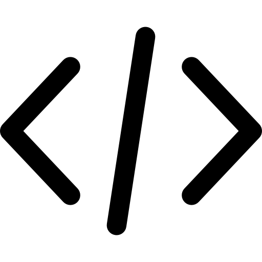

<table border="0" cellpadding="0">
<tr>
<td valign="top">
PhD Candidate 
Department of Computer Science 
Stanford University 
Email: ajroot [at] cs [dot] stanford [dot] edu 
<a href="/assets/cv.pdf">Curriculum Vitae</a> 
<a href="https://scholar.google.com/citations?user=ePuWx50AAAAJ">Google Scholar</a> 
<a href="https://github.com/rootjalex/">GitHub</a>
</td>
<td valign="top" style="min-width:140px;position: relative;text-align: end;padding-right: 2em;">

</td>
</tr>
</table>

<h3 class="tableheading" style="padding-top: 10px;">About</h3>

I design compilers and programming systems that make it tractable to write high-performance code for irregular computations. My goal is to make asymptotically efficient and architecture-aware code as easy to write as naive code.

<!-- **Academic** -->
I am a PhD candidate in Computer Science at Stanford University, advised by <a href="https://fredrikbk.com">Fredrik Kjolstad</a>.
I also work closely with <a href="https://graphics.stanford.edu/~kayvonf/">Kayvon Fatahalian</a>.
I received my S.B. (2021) and M.Eng. (2022) from MIT, advised by <a href="https://people.csail.mit.edu/jrk/">Jonathan Ragan-Kelley</a>, <a href="https://andrew.adams.pub">Andrew Adams</a>, and <a href="https://people.csail.mit.edu/fredo/">Fr&eacute;do Durand</a>.

<!-- **Industry** -->
I have interned with <a href="https://research.nvidia.com/research-area/programming-languages-systems">NVIDIA's Programming Systems and Applications</a> group (2026), <a href="https://research.nvidia.com/labs/rtr/">NVIDIA's Real-Time Graphics</a> group (2025), <a href="https://research.adobe.com/research/systems-languages/">Adobe's Programming Languages and Performance</a> group (2021 - 2023), and <a href="https://www.linkedin.com/company/inteonco/">Intel's Inteon</a> team (2021).

<!-- **Support** -->
I am grateful for support from the <a href="https://blogs.nvidia.com/blog/graduate-fellowship-recipients-2026-2027/">NVIDIA Graduate Fellowship</a> (2026 - 2027), the <a href="https://www.qualcomm.com/research/university-relations/innovation-fellowship/2025-north-america">Qualcomm Innovation Fellowship</a> (2025 - 2026), the <a href="https://www.nsf.gov/funding/opportunities/grfp-nsf-graduate-research-fellowship-program">NSF GRFP</a> (2022 - 2025), and a Stanford School of Engineering Fellowship (2022 - 2023).

<!--   -->

<h3 class="tableheading" style="padding-top: 10px;">Research</h3>

High-performance applications must balance interacting tradeoffs between work, memory,
and compute efficiency. I build domain-specific languages and compilers that
let programmers explore these tradeoffs productively, and that optimize them automatically
where possible. I am particularly interested in *irregular* and *divergent* applications, such as
sparse array programming, relational algebra, and spatial queries, where the best choices are
data-dependent, making them especially challenging to optimize.
My past and ongoing projects explore:

- **Work efficiency** via fusion, for sparse array programming ([Burrito [OOPSLA '24]](/publications/oopsla2024-burrito.pdf)), spatial queries ([Bonsai [PLDI '26]](/publications/pldi2026-bonsai.pdf)), and relational algebra (Chimi, ongoing).
- **Memory efficiency** via data layout specifications, for trees ([Scion [PLDI '26]](/publications/pldi2026-scion.pdf)) and tabular data (Pleach, ongoing).
- **Compute efficiency** on CPUs and GPUs via:
  - Load balancing for sparse tensor algebra ([Nacho [ASPLOS '27]](https://arxiv.org/abs/2604.17198)), spatial queries ([Grove [arXiv '26]](https://arxiv.org/abs/2611.22183)), and relational algebra (Chimi, ongoing).
  - Vectorization and instruction selection for digital signal processing ([Rake [ASPLOS '22]](/publications/asplos2022-rake.pdf) and [Pitchfork [ASPLOS '23]](/publications/asplos2023-pitchfork.pdf)), spatial queries ([Grove [arXiv '26]](https://arxiv.org/abs/2611.22183)), and sparse tensor algebra (Taquito, ongoing).

For spatial queries, the [Bonsai compiler](https://github.com/rootjalex/bonsai) (which includes the Scion, Grove, and Pleach extensions) explores these directions together, letting programmers productively co-optimize work, memory, and compute efficiency.

<!-- - Memory layout control (and automatic optimization) for tabular data structures.
- Automatic parallelization, loop ordering, and index selection for relational queries on GPUs.
- A push-model user-schedulable language for parallelizing divergent and recursive workloads.
- Automatic parallelization of (multi-)sparse tensor algebra onto GPUs and multicore CPUs.
- A language for exploring the memory layout of tree data structures (recursive ADTs).
- Compiling spatial queries on sets into asymptotically efficient tree traversals.
- Automatically determining loop ordering, tiling, and formats for sparse tensor algebra kernels.
- Compiling and fusing shape operators (e.g., reshape) and convolutions for sparse arrays.

At MIT, I worked on vector instruction selection, fixed-point computing systems, and bounds
inference, primarily in the context of the <a href="https://halide-lang.org/">Halide</a> compiler. -->

<h3 class="tableheading" style="padding-top: 10px;">Publications</h3>

* denotes equal contribution.

<!-- <table border="0" style="margin: 0;"> -->
<!-- <table border="0" style="margin: 0; border-collapse: collapse;"> -->
<table border="0" style="margin: 0; border-spacing: 2px 0px;">
  
    
    
    <tr>
      <td style="margin-left: 1em; text-align: right; flex: 0 0 90px; width: 15%">{{ pub.acronym }} {{ pub.year }}</td>
      <td style="width: 2.5%"></td>
      <td style="font-size: 1.1em; line-height: 1.25; hyphens: none; margin-bottom: 0.2em; text-decoration: underline;">
      
        <a href="{{pub_keyval[0]}}.html" style="color: #464646">
      
      {{ pub.title }}
      
        </a>
      
      </td>
    </tr>
    <tr>
      <td style="padding: 0;"></td>
      <td style="width: 2.5%; padding: 0;"></td>
      <td style="font-style: italic; padding: 0; line-height: 1.0">{{ pub.venue }}</td>
    </tr>
    <tr>
      <td></td>
      <td style="width: 2.5%"></td>
      <td>
      <!-- for loop of authors -->
        
          
            and
          
          
            <b style="color: #000">{{ site.data.authors[author].name }}</b>
          
            <a href="{{- site.data.authors[author].site -}}" style="color: #464646">{{ site.data.authors[author].name }}</a>
          

          
            *
          

          
            ,
          
        
      </td>
    </tr>
    
    <tr style="height: 10%;">
      <td></td>
      <td style="width: 2.5%"></td>
      <td style="padding:0px; margin:0px;">
        
          <a href="{{ pub.pdf }}"> Paper</a>
        
          <a href="{{ pub.preprint }}"> Preprint</a>
        
        
          <a href="{{ pub.code }}"> Code</a>
        
      </td>
    </tr>
    
    <tr style="height: 10%;">
      <td></td>
      <td style="width: 2.5%"></td>
      <td style="padding:0px; margin:0px;">
        <em>Paper draft coming soon!</em>
      </td>
    </tr>
    

    
    <tr>
      <td style="padding: 0;"></td>
      <td style="width: 2.5%; padding: 0;"></td>
      <td style="color: #6d09ba; font-weight: bold; padding: 8px 0 0 0; margin: 0; line-height: 1.2;">
        {{ pub.award }}
      </td>
    </tr>
    

    <tr aria-hidden="true" style="line-height: 0; font-size: 0;">
      <td colspan="3" style="padding: 0; height: 12px;"></td>
    </tr>
    
  
</table>

<!--   -->

<h3 class="tableheading" style="padding-top: 10px;">Teaching</h3>
I enjoy teaching and have been involved with compilers classes at both Stanford and MIT. I also TAed MIT's introductory algorithms class.

<table border="0" style="margin: 0;">

  
  <tr>
  <td> 
    
    
    <a href="{{teaching.url}}" style="color: #464646;">
    
    {{teaching.title}}
    
    </a>
    
     {{teaching.role}}, {{teaching.month}} {{teaching.year}}, {{teaching.venue}}
  </td>
  </tr>

</table>

<em>Site Last Updated {{ site.time | date: "%B %Y" }}</em>

